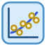

# DataScience

<p align="center">
  <a href="https://andrew1407.github.io/DataScience/" title="Open the labs in the browser">
    
  </a>
</p>

[](https://andrew1407.github.io/DataScience/)

A collection of Python data-science labs covering statistical data analysis, anomaly detection and signal cleaning, time-series forecasting, multi-criteria decision making, credit scoring, and computer-vision object detection. Each lab is a standalone folder with its own `main.py` entry point and `requirements.txt`.

## Labs

| Lab | Topic | Highlights |
| --- | --- | --- |
| [`1-lab`](1-lab/main.py) | Synthetic data analysis | Generates normal/exponential distributions and square/constant trends, composes them, and computes median, variance, and dispersion with histogram and dynamics plots. |
| [`2-lab`](2-lab/main.py) | Anomaly cleaning (least squares) | Injects abnormal noise into a trend, then detects and removes it with a least-squares (MNK) sliding-window detector; tunes detector parameters in parallel via a confusion-matrix/TPR score. |
| [`3-lab`](3-lab/main.py) | Anomaly cleaning (Kalman) | Cleans abnormal values using a second-order Kalman filter, outlier rejection, and an aging-based anomaly detector. |
| [`4-lab`](4-lab/main.py) | Multi-criteria decision making | Applies the Voronin integral-convolution method to rank route/product options read from an Excel table. |
| [`5-lab`](5-lab/main.py) | Time-series forecasting (XGBoost) | Fetches the OWID COVID-19 dataset, engineers date features, and forecasts new cases with an `XGBRegressor`, plotting predictions and feature importances. |
| [`6-lab`](6-lab/main.py) | Forecasting (MNK + neural net) | Uses the Jena climate dataset to extrapolate atmospheric pressure via least squares and predict it with a TensorFlow/Keras dense network. |
| [`7-lab`](7-lab/main.py) | Sales data analysis | Reads an Excel sales dataset and performs MNK flattening/extrapolation, rolling statistics, and segmentation/generalization by item and region. |
| [`8-lab`](8-lab/main.py) | Credit scoring pipeline | Cleans and normalizes loan applicant data, builds an integro score (Voronin), filters fraud via rule-based validation, smooths anomalies, and trains a Keras model to predict the score. |
| [`9-lab`](9-lab/main.py) | Computer vision (object detection) | Runs YOLOv3 weapon detection over input images with OpenCV's DNN module and non-maximum suppression, drawing bounding boxes. |
| [`control-work`](control-work/main.py) | Statistical analysis | Analyzes a normal distribution combined with a periodic (cosine) trend. |

## Showcase

**[Open the labs in the browser](https://andrew1407.github.io/DataScience/)**. Labs 1–8 and the control work run from their own source code in [Pyodide](https://pyodide.org), in a Web Worker so training never freezes the page, with editable parameters. Every figure a lab plots is drawn as an interactive chart, and each chart (PNG or CSV), table, printed output and set of results can be copied.

- **What runs natively:** [`web/showcase.py`](web/showcase.py) runs each lab's `main.py` unchanged. It records the `matplotlib` calls instead of opening windows and replaces the lab's constants with the page's inputs. NumPy, pandas, scikit-learn and XGBoost are Pyodide's own packages, so labs 1–5, 7 and the control work run exactly as written.
- **What's ported:** TensorFlow isn't available in the browser. In labs 6 and 8, `import tensorflow` gets a small stand-in whose `keras.Sequential` of `Dense` layers trains scikit-learn's `MLPRegressor` with the same layer sizes, optimiser, learning rate, batch size and epochs. Lab 2's `ThreadPoolExecutor` runs its jobs one after another, because Pyodide has no threads.
- **Data:** labs 5 and 6 get build-time extracts of the OWID COVID-19 and Jena climate datasets from [`web/build_data.py`](web/build_data.py). The Excel inputs of labs 4, 7 and 8 aren't in the repository, so [`web/datagen.py`](web/datagen.py) writes clearly labelled synthetic workbooks with the same layout.

Run it locally:

```sh
python web/build_data.py                          # downloads the datasets into web/data/
python -m http.server                             # then open http://localhost:8000/web/
```

## Tech stack

- Python (3.10+ syntax)
- NumPy, pandas
- Matplotlib, seaborn
- scikit-learn, SciPy
- XGBoost
- TensorFlow / Keras
- OpenCV (`opencv` DNN module, YOLOv3)
- requests, xlrd / openpyxl (Excel I/O)

Not every lab uses every library; see each lab's `requirements.txt` for its exact dependencies.

## Running

Each lab is independent. From a lab directory, install its dependencies and run its entry point:

```bash
cd 1-lab
pip install -r requirements.txt
python main.py
```

Notes on data inputs (these paths are git-ignored and must be supplied locally):

- [`4-lab`](4-lab/main.py) expects Excel tables under `tables/` (`routes.xls`, `Pr1.xls`).
- [`5-lab`](5-lab/main.py) and [`6-lab`](6-lab/main.py) download their datasets automatically (OWID COVID-19 CSV; Jena climate ZIP) and cache them locally.
- [`7-lab`](7-lab/main.py) expects `Data_Set_3.xls` in the lab directory.
- [`8-lab`](8-lab/main.py) reads Excel files from `input/` and writes results to `output/`.
- [`9-lab`](9-lab/main.py) expects images in `input/` and the YOLOv3 model files (`yolov3_training_2000.weights`, `yolov3_testing.cfg`) under `model/`.

## Project structure

```
.
├── 1-lab/          # synthetic distributions, trends, statistics
├── 2-lab/          # MNK sliding-window anomaly detection
├── 3-lab/          # Kalman-based anomaly cleaning
├── 4-lab/          # Voronin multi-criteria decision making
├── 5-lab/          # XGBoost COVID-19 forecasting
├── 6-lab/          # MNK + Keras climate forecasting
├── 7-lab/          # Excel sales analysis & segmentation
├── 8-lab/          # credit scoring pipeline
│   ├── datasamples/        # data formatting, loggers, utils
│   └── scoring_analysis/   # predictor, validation, anomalies, tools
├── 9-lab/          # YOLOv3 weapon detection (OpenCV)
├── control-work/   # normal distribution + periodic trend analysis
└── web/            # in-browser showcase (Pyodide in a Web Worker), deployed to GitHub Pages
```
